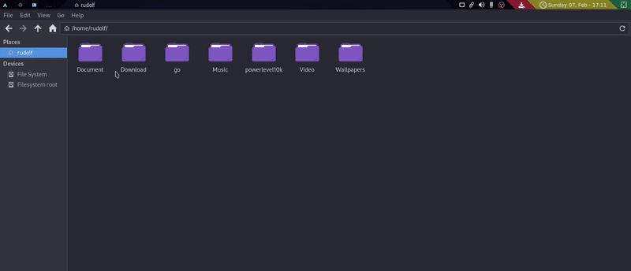

## Organizer

### Description

Organizer is a Rust script to organize the Download directory in diferent directories depending of the file extension.
<hr>

### Install

1. Install rustup.
2. Download this repository.
```console
git clone https://github.com/ghaerdi/file-organizer.git
```
3. Run `install.sh` in the directory.

### How to use

```console
organizer
```
You can also pass a directory as argument using relative path if you want specify the folder to organize.

```console
organizer [--dry-run] [--by-date] [--revert] [DIR]
```

| Flag | Effect |
|------|--------|
| `--dry-run` | Preview the moves without touching any file (shown as a tree, with the `--by-date` nesting) |
| `--by-date` | Group files into `Category/YYYY/MM/` inside their category by modification date |
| `--revert` | Undo the most recent run on `DIR` (or `$HOME/Downloads`): move every file back where it came from |

Every run that moves files appends a JSON register (one line per run) to a
local state file at `~/.local/state/file-organizer/register.log` (honouring
`$XDG_STATE_HOME` when set). The register records the source and destination of
each file, so `--revert` can replay the moves in reverse and restore the
original layout. If a destination is already occupied when reverting, the file
is given a numeric suffix (e.g. `a-1.txt`) rather than overwriting anything.
Reverting also removes the branch (category and `YYYY/MM/` subfolders) when a
reverted move leaves it empty, so a fully-undone run restores the directory to
its pre-organization layout. Reverting removes the restored run from the
register and a second `--revert` undoes the run before it.

The register lives in the user's state directory rather than the config
directory, so it is local to the machine, survives reboots (runs older than the
last boot can still be reverted), and stays out of your `~/.config`.
Files are grouped into these categories by extension: `Text`, `Image`, `Video`,
`Audio`, `Compressed`, `Executable`, `Code`, `Data`, `Disk`, `Font`, and `Other`.

When a file's name already exists in a category, the incoming file is renamed
with a numeric suffix (e.g. `report-1.pdf`) instead of overwriting the original.
Symlinks are left untouched.

Category directories are created lazily: only categories that actually receive
files are materialised, so a run that touches only `Text` and `Image` leaves the
other categories uncreated.

Output is colour-coded when the program runs in a terminal and falls back to
plain text when piped to a file or another command. Category directories are
bold blue, file leaves are bold green (moved) or bold yellow (previewed), the
tree's `├──`/`└──` connectors are dim gray, and the summary line is a muted
cyan so the tree stays the focal point.
[](./example.gif)

Note: The script require the `$HOME/Downloads` directory when no command is passed.
